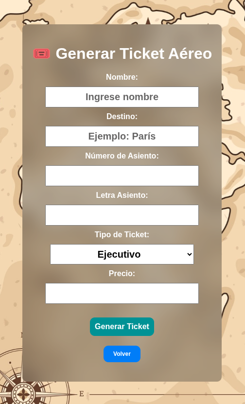
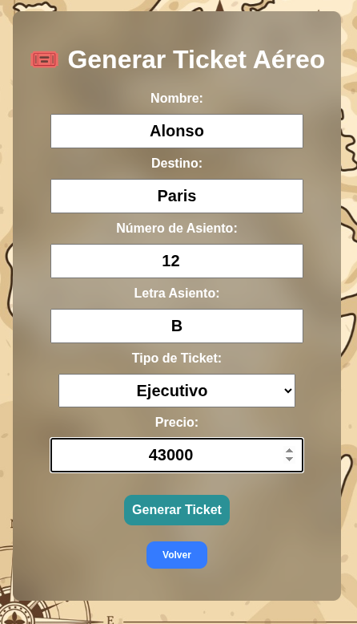
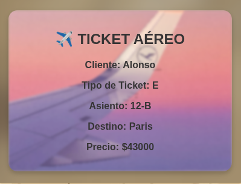

# ✈️ AppAvion - Sistema de Gestión de Tickets Aéreos

Aplicación web desarrollada para gestionar la venta y generación de tickets aéreos mediante reglas de negocio específicas.

El sistema permite registrar información de vuelos y pasajeros, validando automáticamente distintos campos como nombre del cliente, tipo de ticket, precio y número de asiento.

Proyecto desarrollado completamente con HTML, CSS y JavaScript puro.

---

# 📸 Vista General





La aplicación permite:

- Generar tickets aéreos
- Validar datos del cliente
- Aplicar reglas de negocio automáticamente
- Visualizar tickets generados dinámicamente
- Gestionar distintos tipos de tickets

---

# 🧠 Lógica de Negocio

La aplicación fue desarrollada siguiendo las siguientes reglas:

| Regla | Comportamiento |
|---|---|
| Nombre menor a 6 caracteres | Se asigna `"NO ASIGNADO"` |
| Tipo inválido o vacío | Se asigna `"Turista"` |
| Precio negativo | Se convierte en `0` |
| Número de asiento fuera de rango | Se marca como inválido |

---

# 🎯 Funcionalidades

- Generación dinámica de tickets
- Validación automática de datos
- Sistema de clases en JavaScript
- Visualización personalizada del ticket
- Interfaz moderna con efecto blur
- Fondo temático de aviación
- Navegación hacia portafolio principal
- Diseño responsive

---

# 🛠️ Tecnologías Utilizadas

## Frontend

- HTML5
- CSS3
- JavaScript ES6

---

# ⚙️ Arquitectura del Proyecto

El proyecto utiliza programación orientada a objetos mediante la clase:

```javascript
class Vuelo
```

La clase encapsula:

- Validación de datos
- Generación del ticket
- Reglas de negocio
- Formateo de información

---

# 📂 Estructura del Proyecto

```bash
TicketAvion/
├── readme-img/
├── img/
├── index.html
├── README.md
├── script.js
└── styles.css
```

---

# ✈️ Datos Gestionados

Cada ticket almacena:

- Número de vuelo
- Destino
- Número de asiento
- Letra de asiento
- Tipo de ticket
- Precio
- Nombre del cliente

---

# 🎟️ Tipos de Ticket

| Código | Tipo |
|---|---|
| `E` | Ejecutivo |
| `T` | Turista |

---

# 🔍 Validaciones Implementadas

## 👤 Nombre del Cliente

```javascript
validarNombreCliente(nombre)
```

- Mínimo 6 caracteres
- Si no cumple:
  
```txt
NO ASIGNADO
```

---

## 💰 Precio

```javascript
validarPrecio(precio)
```

- No permite valores negativos
- Valores inválidos → `0`

---

## 💺 Número de Asiento

```javascript
validarNumeroAsiento(asiento)
```

Rango permitido:

```txt
1 - 853
```

---

## 🛫 Tipo de Ticket

```javascript
validarTipoTicket(tipo)
```

Valores válidos:

- `E`
- `T`

Caso contrario:

```txt
Turista
```

---

# 🎨 Diseño de Interfaz

La interfaz incluye:

- Fondo temático de aviación
- Efecto Glassmorphism
- Blur dinámico
- Ticket visual estilizado
- Botones interactivos
- Inputs centrados y responsivos

---

# 📦 Instalación y Uso

## 1️⃣ Clonar repositorio

```bash
git clone https://github.com/alonsocuevas/TicketAvion.git
```

---

## 2️⃣ Entrar al proyecto

```bash
cd TicketAvion
```

---

## 3️⃣ Ejecutar

Abrir:

```bash
index.html
```

En cualquier navegador moderno.

---

# 🌐 Demo Online

Disponible en GitHub Pages:

```txt
https://alonsocuevas.github.io/TicketAvion/
```

---

# 🧪 Conceptos Aplicados

Este proyecto permitió practicar:

- Programación orientada a objetos
- Validación de formularios
- Manipulación del DOM
- Reglas de negocio
- Renderizado dinámico HTML
- CSS moderno
- Glassmorphism UI
- Manejo de eventos

---

# 🔧 Dependencias

Este proyecto no utiliza:

- Node.js
- npm
- frameworks
- backend
- base de datos
- variables de entorno

Todo el sistema funciona mediante archivos estáticos.

---

# 📱 Compatibilidad

Compatible con:

- Google Chrome
- Firefox
- Edge
- Brave
- Opera

---

# 📈 Posibles Mejoras Futuras

- Persistencia de tickets
- Base de datos
- Generación PDF
- Tickets descargables
- Sistema de autenticación
- Gestión de vuelos
- Panel administrativo
- Integración backend
- API REST

---

# 👨‍💻 Autor

## Alonso Cuevas Pizarro

Desarrollador Web Full Stack enfocado en:

- JavaScript
- React
- Node.js
- PostgreSQL
- Desarrollo Frontend
- Interfaces interactivas

---

# 🔗 Enlaces

## 💻 GitHub

```txt
https://github.com/alonsocuevas
```

## 🌐 Portafolio

```txt
https://alonsocuevas.github.io/dev/
```

---

# ✈️ Objetivo del Proyecto

Proyecto desarrollado con fines educativos para practicar:

- Validaciones
- Reglas de negocio
- Programación orientada a objetos
- Desarrollo frontend
- Simulación de sistemas reales de tickets aéreos